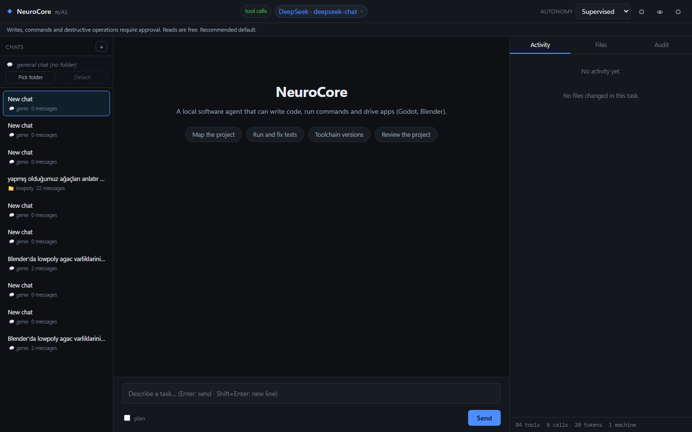
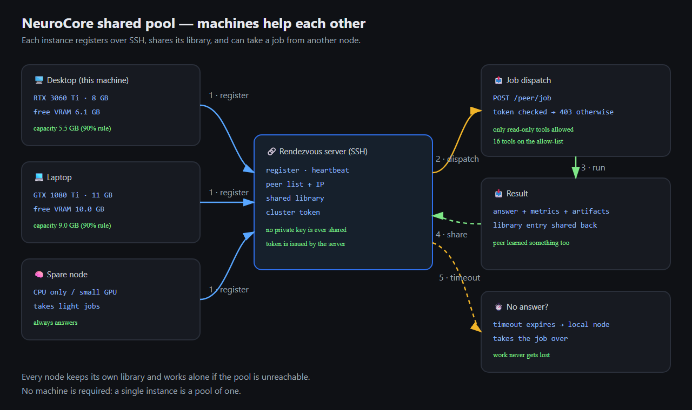
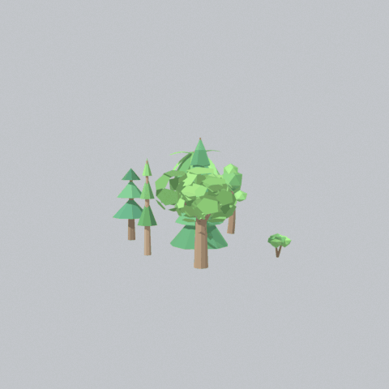
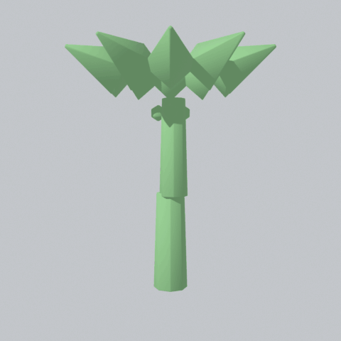

# NeuroCore

**🇬🇧 English (this page)** · 🇹🇷 Türkçe: [README.tr.md](README.tr.md)

**A local-first AI agent for your own computer.** It plans, calls tools
(shell, code, Blender, Godot), keeps a markdown knowledge vault, trains a
small neural model in the background, and can share work with other
NeuroCore machines over SSH — never spending more than 90 % of the resources
you actually have free.



<sub>Real screenshot (`?lang=en`): DeepSeek provider active, 83 tools registered, 20 tokens on the status bar. The UI ships Turkish and switches to English automatically when your browser is not Turkish.</sub>

---

## Table of contents

1. [What it does](#1-what-it-does)
2. [Machines help each other](#2-machines-help-each-other-shared-pool)
3. [How it works](#3-how-it-works)
4. [Requirements](#4-requirements)
5. [Install (GPU-aware)](#5-install-gpu-aware)
6. [Add your API key](#6-add-your-api-key)
7. [First run](#7-first-run)
8. [Verify your machine](#8-verify-your-machine)
9. [Hardware support matrix](#9-hardware-support-matrix)
10. [Using it in English](#10-using-it-in-english)
11. [Output examples](#11-output-examples)
12. [Known limits](#12-known-limits)

---

## 1. What it does

| Capability | What you get |
|---|---|
| **Agent loop** | plan → tool call → observe → verify → answer (bounded, with reflection and recovery) |
| **Tools** | 83 registered: filesystem, shell, code editing, diagnosis, Blender, Godot, docs, vision, web |
| **Knowledge vault** | Obsidian-compatible markdown notes with frontmatter, searchable, used as retrieval source |
| **Local model** | 211M-parameter model trained from scratch on your own notes (0.51 tokens/param so far) |
| **Cognition layer** | error taxonomy, goal state, self-reflection, evidence verification (max 2 reflections, 1 correction) |
| **Puzzle planner** | any task becomes **nested phases** (phases inside phases) with a **walkthrough** — clarifying questions at every phase; you can say "change this part" and the agent revises that piece |
| **Learning** | successful work flows are stored as *playbooks* and suggested on similar tasks |
| **Resource governance** | `spendable = total × (1 − current) × 0.90`, hard ceiling 85 % |
| **Shared pool** | machines register over SSH and take dispatched jobs; local node takes over if a peer does not answer |

## 2. Machines help each other (shared pool)

Every running instance can join a **shared pool**: machines register over SSH,
publish what they can contribute, and take jobs from each other. If a
dispatched machine does not answer in time, the **local node takes the job
over** — work never gets lost.



<sub>Editable source: [`docs/images/pool-diagram.svg`](docs/images/pool-diagram.svg) — regenerate the PNG with any SVG renderer.</sub>

How it works, step by step:

| # | Step | Detail |
|---|---|---|
| 1 | **Register** | each node opens one SSH connection and sends host + capacity; the server fills the IP itself (`$SSH_CLIENT`) |
| 2 | **Heartbeat** | repeats on a timer so peers know who is alive |
| 3 | **Dispatch** | `POST /peer/job` with the cluster token — **403** if the token is missing or wrong |
| 4 | **Run** | the peer executes with **read-only tools only** (16-item allow-list) |
| 5 | **Share back** | result + metrics return; the library entry is shared too |
| 6 | **Take over** | no answer within the timeout → the local node runs the job |

**Security rules** (they are enforced, not aspirational):

```text
· the SSH private key is NEVER shared between clients
· the cluster token is issued by the server (not derived from the key)
· peer jobs may only call read-only tools
· /peer/job is closed by default — no token, no endpoint
```

Resource rule used for every job (measured from live usage):

```text
spendable = total × (1 − current) × 0.90      hard ceiling 85 %
e.g. 50 % used → spend up to 45 %   ·   90 % free → spend up to 81 %
```

## 3. How it works

```text
                 ┌──────────────────────────────┐
   your task ───▶│  AgentLoop (agent/loop.py)   │
                 │  plan → act → verify         │
                 └───────┬───────────┬──────────┘
                         │           │
          tools (83) ────┘           └──── cloud LLM (DeepSeek / Gemini / Groq)
     files · shell · code ·                 │
     Blender · Godot · docs                 └─ if unavailable → failover chain
                         │
                 ┌───────▼──────────────┐
                 │  Cognition layer     │  error taxonomy · goal state
                 │  (agent/cognition)   │  reflection (≤2) · verification (≤1)
                 └───────┬──────────────┘
                         │
        ┌────────────────┼─────────────────┐
        ▼                ▼                 ▼
  knowledge vault   local model      playbooks
  (markdown notes)  (trainer,        (successful
                     growth.json)     tool sequences)
```

**The brain is a cloud LLM; the local model is trained, not used as the brain.**
That is why the agent works on weak hardware while the local model keeps
learning in the background.

## 4. Requirements

| Item | Minimum | Notes |
|---|---|---|
| OS | Windows 10/11 | Windows-first (PowerShell tools) |
| Python | 3.10 | 3.10.11 tested |
| GPU | any NVIDIA with 6 GB+, or CPU | see [matrix](#8-hardware-support-matrix) |
| Disk | 8 GB | PyTorch + model + vault |
| Accounts | one LLM API key | DeepSeek is the default and cheapest |

## 5. Install (GPU-aware)

The installer **detects your GPU and picks the matching PyTorch build**.
Nothing is hard-coded to CUDA 12.4 any more.


### Windows — one-click setup

```bat
Kurulum.bat          :: Turkish name
installation.bat     :: English name (same installer, forwards all arguments)

# Linux / macOS
bash kur_istemci.sh            # GPU auto-detect (CUDA / ROCm / CPU)
bash installation.sh           # same, English name
bash installation.sh --systemd # + systemd user service
bash installation.sh --desktop # + desktop entry
```

Python is found automatically (`.venv` → `py` launcher → PATH → common folders → registry).
No machine-specific path is hardcoded. If your Python lives elsewhere:

```bat
set NC_PYTHON=C:\tools\Python312\python.exe
Kurulum.bat
```

Need the system interpreter instead of a virtualenv? `Kurulum.bat --no-venv`.

```powershell
git clone https://github.com/termikprogram/neurocore.git
cd neurocore
Set-ExecutionPolicy -Scope Process Bypass -Force
.\kur_istemci.ps1
```

### Check what it would pick (no installation)

```powershell
.\kur_istemci.ps1 -SadeceGpu
```

Measured output on a GTX 1080 Ti:

```text
── 2b) GPU ALGILAMA ve PyTorch SEÇİMİ
  GPU        : NVIDIA GeForce GTX 1080 Ti
  sürücü     : 582.78
  PyTorch    : cu124
  gerekçe    : NVIDIA sürücü 582 → cu124
```

### Detection rules

| Detected | PyTorch build |
|---|---|
| NVIDIA driver ≥ 550 | `cu124` |
| NVIDIA driver ≥ 525 | `cu121` |
| NVIDIA driver < 525 | `cu118` |
| AMD / Radeon on **Windows** | `cpu` (ROCm does not exist on Windows) |
| Intel GPU | `cpu` |
| No GPU | `cpu` |

Override any time:

```powershell
.\kur_istemci.ps1 -Torch cu121     # or cu124 / cu118 / cpu / auto (default)
```

### Manual install

```powershell
python -m venv .venv
# NVIDIA
.venv\Scripts\python.exe -m pip install torch --index-url https://download.pytorch.org/whl/cu124
# CPU only
.venv\Scripts\python.exe -m pip install torch --index-url https://download.pytorch.org/whl/cpu
.venv\Scripts\python.exe -m pip install -r requirements.txt
```

### Linux / macOS

```bash
bash kur_istemci.sh              # detects GPU, picks the wheel
bash kur_istemci.sh --sadece-gpu # print the decision only
```

Detection: `nvidia-smi` → `cu124`/`cu121`/`cu118`; `rocminfo` or `/opt/rocm` →
`rocm6.2`; macOS → `cpu`; no GPU → `cpu`.

**AMD on Linux (ROCm)** — use the ROCm wheel, the code needs no changes
because PyTorch exposes ROCm through `torch.cuda.*`:

```bash
pip install torch --index-url https://download.pytorch.org/whl/rocm6.2
```

## 6. Add your API key

Three equivalent ways. The key is stored locally and **never returned** by
the API.

### 5.1 From the app (recommended)

1. Open the app (`.\BASLAT-istemci.bat` or `python -m neurocore.app`).
2. Click the **gear icon** (top right) → **Dil Modeli / Language model**.
3. Pick a provider, paste the key, press **Bağlantıyı sına** (test).
4. Press save. The status pill in the header turns into `DeepSeek · deepseek-chat`.

### 5.2 From a file

`.neurocore/llm_credentials.json` (git-ignored):

```json
{
  "keys": { "deepseek": "sk-..." },
  "models": { "deepseek": "deepseek-chat" },
  "base_urls": {},
  "provider": "deepseek",
  "updated_at": "2026-10-29T00:00:00"
}
```

### 5.3 From environment variables

| Provider | Variable |
|---|---|
| DeepSeek (default) | `DEEPSEEK_API_KEY` |
| Google Gemini | `GEMINI_API_KEY` |
| OpenAI | `OPENAI_API_KEY` |
| Groq | `GROQ_API_KEY` |
| OpenRouter | `OPENROUTER_API_KEY` |
| Together | `TOGETHER_API_KEY` |

```powershell
[Environment]::SetEnvironmentVariable("DEEPSEEK_API_KEY", "sk-...", "User")
```

Providers are tried in order with automatic failover; if one is rate-limited
the next one answers.

## 7. First run

```powershell
.\BASLAT-istemci.bat
```

The window opens at `http://127.0.0.1:8791`. Type a task. Autonomy levels:

| Level | Behaviour |
|---|---|
| `danışman` (advisor) | asks before anything that writes |
| **`denetimli` (supervised)** | default: writes/commands need approval, reads are free |
| `güvenilir` (trusted) | writes allowed, destructive commands still ask |
| `yolo` | everything except sandbox escape |

Example tasks that were actually run:

```text
"Create a low-poly palm tree in Blender and render 4 angles"     → 3 trees + 12 PNGs
"Build a trial blog site in WebTest: index.html, style.css, js"   → 9/9 checks passed
"Read the config, list tools needing write permission, summarise" → report
```

## 8. Verify your machine

```powershell
python tools\kurulum_kontrol.py     # 36 environment checks
python tools\kabiliyet_olc.py       # 10 capability checks, offline, <1 s
python tools\model_payi.py          # local vs cloud model usage
```

`kurulum_kontrol.py` now reports the backend explicitly:

```text
[✓] GPU backend    torch 2.6.0+cu124 · CUDA 12.4 (NVIDIA)
                   ↳ AMD/Linux: ROCm 6.x (AMD)  ·  no GPU: CPU
```

## 9. Hardware support matrix

| GPU | VRAM | Backend | Status | Notes (measured) |
|---|---|---|---|---|
| GTX 1080 Ti (Pascal) | 11 GB | CUDA | ✅ **tested** | fp16/fp32 only; `--batch 8 --amp-yok` (driver TDR + fp16 underflow) |
| RTX 3060 Ti (Ampere) | 8 GB | CUDA | ✅ expected | native bf16, `--batch 8 --seq 128` |
| RTX 4090 / 5090 | 24–32 GB | CUDA | ✅ expected | bf16 native, batch 32+ |
| A100 / H100 / H200 | 40–141 GB | CUDA | ✅ expected | **single GPU only** (device 0, no NCCL) |
| L40S / RTX 6000 Ada | 48 GB | CUDA | ✅ expected | same as Ada |
| AMD (ROCm, Linux) | 8–192 GB | ROCm | ⚠️ should work | ROCm is visible through `torch.cuda.*`; not tested in this repo |
| AMD (Windows) | — | — | ❌ | no ROCm → CPU fallback |
| Apple Silicon | shared | MPS | ❌ | no MPS branch → CPU |
| Intel Arc / XPU | 8–16 GB | XPU | ❌ | no XPU branch → CPU |

### AMP dtype is chosen automatically

| Hardware | dtype | GradScaler |
|---|---|---|
| Pascal (1080 Ti, sm_61) | `float16` | yes |
| Ampere / Ada / Hopper (sm_80+) | **`bfloat16`** | no (not needed) |
| AMD ROCm gfx90a+ | **`bfloat16`** | no |
| CPU | `float32` | no |

> Pitfall found while implementing: `torch.cuda.is_bf16_supported()` returns
> **True** on a 1080 Ti because PyTorch *emulates* bf16 by upcasting to fp32.
> The selector therefore also requires `compute capability >= 8.0`, so Pascal
> keeps the old fp16 + scaler path (verified: sm_61 → fp16, sm_86/90 → bf16).

**CPU fallback is graceful** — measured: with `torch.cuda.is_available()`
forced to `False`, the resource governor and the model both initialise and
fall back to CPU. The *agent* is unaffected (cloud LLM does the thinking);
only the local training/inference becomes slow.

## 10. Using it in English

The agent answers in the language you write in — the system prompt now
contains an explicit language rule (before: Turkish prompt → Turkish answers
even for English questions).

**Measured tokenizer cost** (vocab 4,679 · 4,408 merges):

| Sample | Words | Tokens | Tokens/word |
|---|---|---|---|
| Turkish #1 | 18 | 45 | **2.50** |
| Turkish #2 | 14 | 27 | **1.93** |
| English #1 | 22 | 66 | **3.00** |
| English #2 | 18 | 56 | **3.11** |
| English #3 | 18 | 63 | **3.50** |

English costs ~20–40 % more tokens; round-trip encode/decode is correct in
both languages. The **local model** remains Turkish-centric (it was trained
on Turkish notes) — the cloud model handles English natively.

**The UI starts in English** and switches to Turkish from
**Settings → Language** — **without a page reload**. `web/i18n.js` keeps a
snapshot of the Turkish source strings, so switching back restores them
exactly. The choice lives in `localStorage` (`neurocore_dil`); `?lang=en|tr`
forces it for a single visit. See also [docs/SPEC.md](docs/SPEC.md) for the technical contract.

## 11. Output examples

**Rotating render of the scene the agent built** (Blender job, 37 tool calls,
302 s — three trees, four angles each):



**Palm rebuilt from the fan recipe** (single-blade fronds, no joint gap):



The still frames are in `docs/images/example-trees.png` and
`docs/images/example-palm.png`; the animations above are generated from the
same `.blend` files with `tools/donus_animasyon.py`.

## 12. Known limits

- **Windows-first**: many tools assume PowerShell and Windows paths.
- **Single GPU**: no multi-GPU / NCCL; big AI cards use one device.
- **No MPS/XPU** backend.
- **Pascal needs small batches**: `--batch 8 --amp-yok`, otherwise driver resets.
- **Local model is small and Turkish-centric** (0.51 tokens/param).
- **UI translation is dictionary-based**: strings not in `web/i18n.js` stay
  Turkish (contributions welcome — one JS object).
- **No multi-GPU / NCCL.**

---

## License

Proprietary — see [LICENSE](LICENSE). Turkish documentation: [README.tr.md](README.tr.md) · English docs folder: [docs/en](docs/en/README.md).

---

## 📚 Documentation / Belgeler

- **Wiki (EN + TR):** <https://github.com/termikprogram/neurocore/wiki>
  - [Getting Started](https://github.com/termikprogram/neurocore/wiki/Getting-Started) · [Big Files](https://github.com/termikprogram/neurocore/wiki/Big-Files) · [Project Index](https://github.com/termikprogram/neurocore/wiki/Project-Index) · [Refactor Guard](https://github.com/termikprogram/neurocore/wiki/Refactor-Guard)
  - Türkçe: [Ana Sayfa](https://github.com/termikprogram/neurocore/wiki/Home-TR)
- **Changelog:** [CHANGELOG.md](CHANGELOG.md) — v0.2.0: big projects, code index, refactor guard
- **Release:** <https://github.com/termikprogram/neurocore/releases/tag/v0.2.0>
